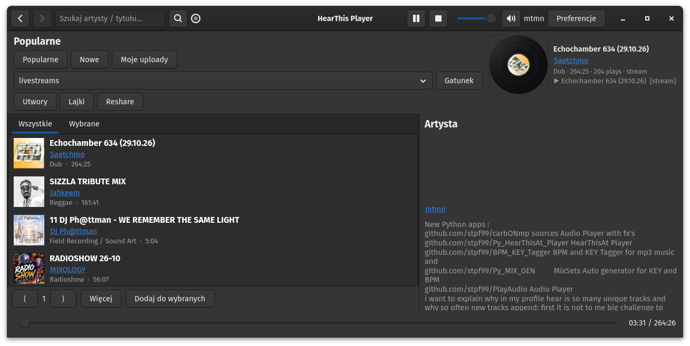

# HearThis Player

Desktopowy odtwarzacz [hearthis.at](https://hearthis.at) napisany w **Python 3 + GTK4 + GStreamer**.

Streamuje utwory z API, dekoduje przez **flump3dec**, opcjonalnie cache’uje lokalnie i pokazuje proceduralną okładkę w stylu **winyl / CD** z obrotem według BPM.



## Funkcje

- Przeglądanie **Popularne / Nowe**, gatunków, profilu artysty
- **Utwory / Lajki / Reshare** (publiczne endpointy API)
- **Moje uploady** po podaniu username (bez hasła)
- Wyszukiwanie artysty / permalink
- Klikalne nazwy wykonawców → przejście do profilu
- Historia nawigacji **undo / redo**
- Odtwarzanie: **stream** (`souphttpsrc → mpegaudioparse → flump3dec`)
- Opcjonalny **cache** (MP3 + JSON z tytułem + okładka)
- Podgląd okładki: `normal` / `vinyl` / `cd` (Cairo, bez zewnętrznych assetów)
- Obrót płyty według **BPM** podczas playback
- Seek, głośność, mute, playlista „Wybrane”

## Wymagania

| Pakiet | Uwagi |
|--------|--------|
| Python 3.10+ | |
| GTK 4 | `python3-gi`, `gir1.2-gtk-4.0` |
| GStreamer 1.x | `gstreamer1.0-plugins-*` |
| **flump3dec** | Fluendo MP3 (`gstreamer1.0-fluendo-mp3` lub odpowiednik) |
| **pycairo** | winyl/CD + spin (`python3-cairo`) |
| requests | `pip install requests` |

### Debian / Ubuntu

```bash
sudo apt install python3-gi gir1.2-gtk-4.0 \
  gstreamer1.0-plugins-base gstreamer1.0-plugins-good \
  gstreamer1.0-pipewire python3-cairo python3-requests

# dekodery MP3 (jeden z):
sudo apt install gstreamer1.0-fluendo-mp3
# albo inny pakiet z flump3dec / libgstflump3dec
```

### Pipeline audio

**Stream (domyślnie):**

```text
souphttpsrc ! queue ! mpegaudioparse ! flump3dec ! audioconvert ! audioresample ! volume ! pipewiresink
```

**Cache (lokalny plik):**

```text
filesrc ! queue ! mpegaudioparse ! flump3dec ! … ! pipewiresink
```

`flump3dec` nie obsługuje URI – dane dostaje z `souphttpsrc` / `filesrc`.

## Uruchomienie

```bash
python3 hearthis_player.py
```

Konfiguracja i cache:

```text
~/.cache/hearthis_player/config.json
~/.cache/hearthis_player/audio/
```

## Preferencje

Przycisk **Preferencje** w headerze:

| Opcja | Opis |
|-------|------|
| Użytkownik | Permalink hearthis.at (bez hasła) |
| Cache lokalny | W tle zapis MP3 + meta + okładka |
| Podgląd okładki | `normal` / `vinyl` / `cd` |
| Obrót wg BPM | Animacja podczas odtwarzania |

## Skróty UI

- **⟨ ⟩** w headerze – poprzednie / następne wyniki (historia)
- Klik w nazwę artysty – profil
- **Moje uploady** – utwory zalogowanego username
- Pasek postępu przy wyszukiwaniu – postęp cache (gdy włączony)

## Pliki

```text
hearthis_player.py   # główna aplikacja
screenshot.png       # zrzut ekranu
README.md
```

## Licencja

Kod przykładowy / hobby – używaj swobodnie. API i treści audio należą do [hearthis.at](https://hearthis.at) i ich autorów.

## Autor / powiązane

Inspiracja i pokrewne projekty (m.in.):

- [Py_HearThisAt_Player](https://github.com/stpf99/Py_HearThisAt_Player)
- [BPM_KEY_Tagger](https://github.com/stpf99/BPM_KEY_Tagger)
- [PlayAudio](https://github.com/stpf99/PlayAudio)

